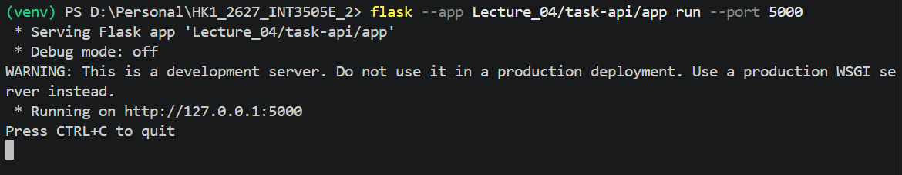
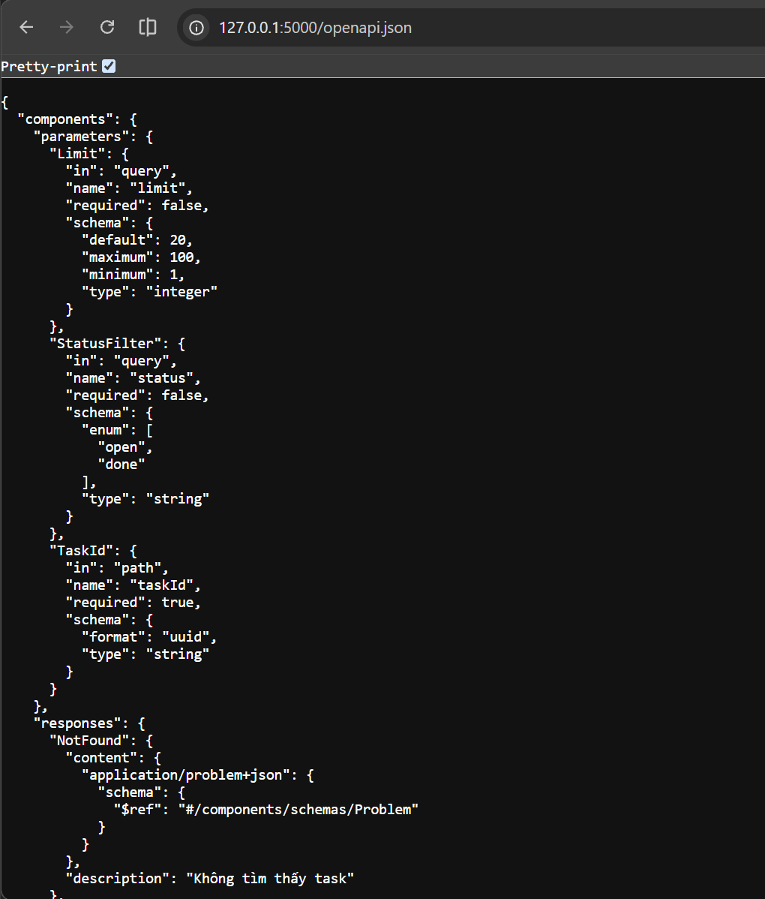
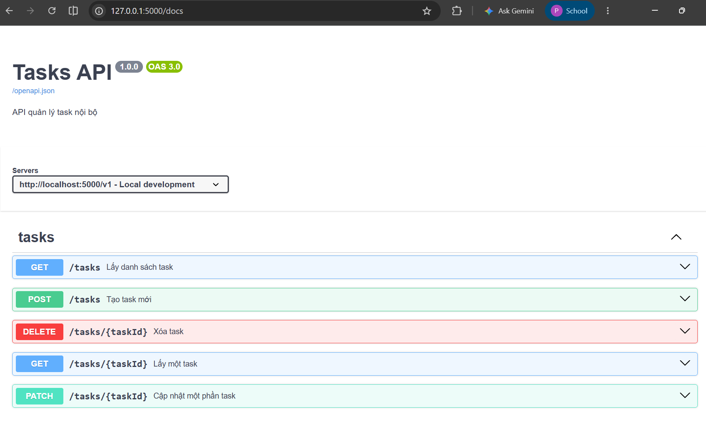
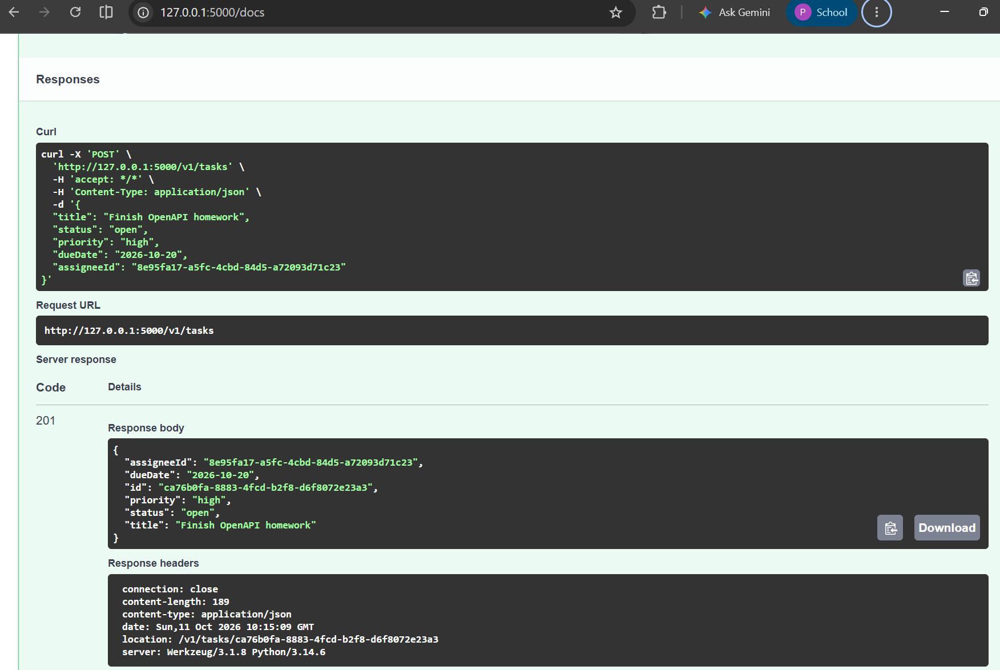
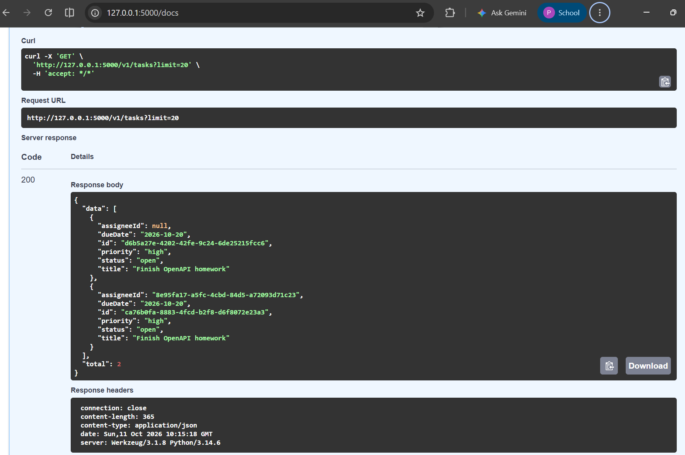
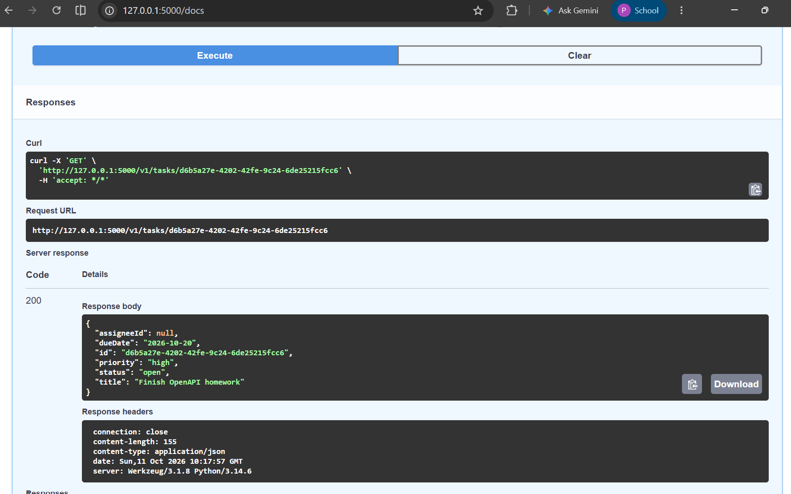
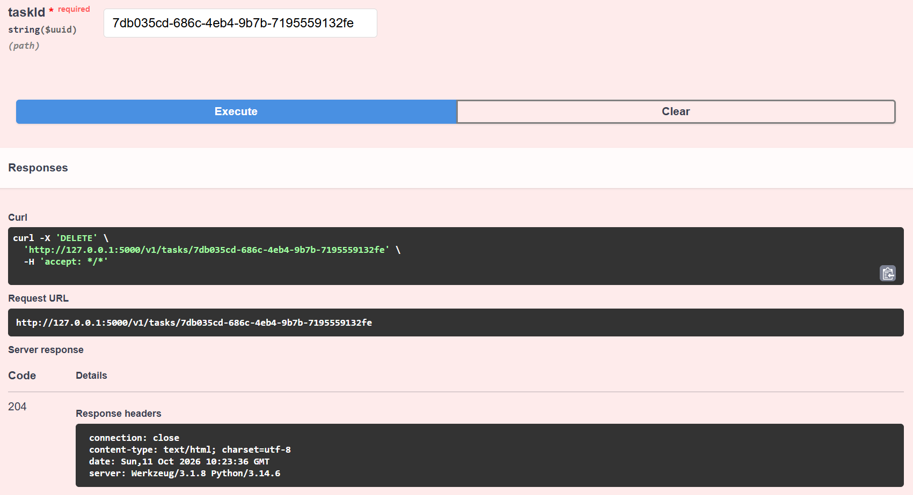
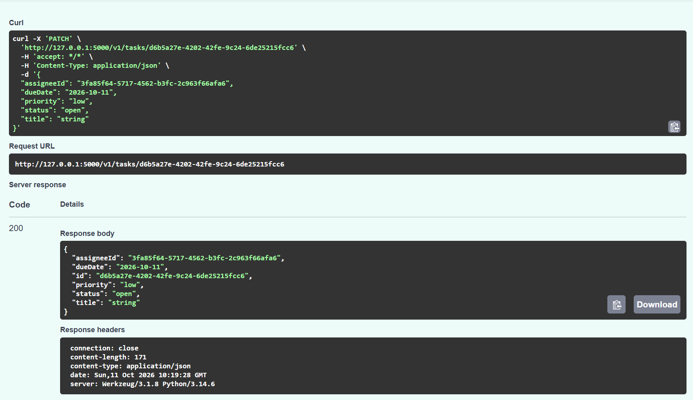

# LECTURE 04

## Implement 5 endpoints GET , GET (by id), POST, PATCH, DELETE and 2 endpoints /openapi.json and /docs

## /openapi.json
Succeed implementing /openapi.json showing the raw API specification

## /docs
Succeed implementing /docs rendering the SwaggerUI

## Testing the SwaggerUI
Testing 5 endpoints using SwaggerUI

### POST endpoint

### GET endpoint

### GET (by id) endpoint

### DELETE endpoint

### PATCH endpoint
