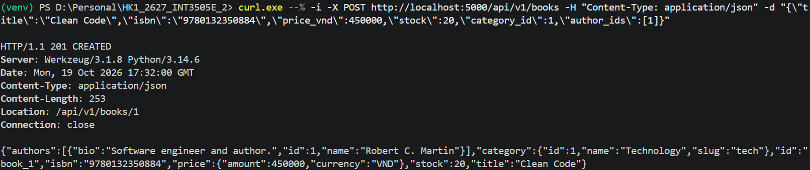
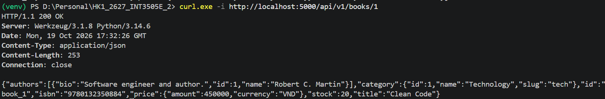

# LECTURE 05

## LAB 01

The bookstore_api has 5 basic endpoints GET, GET(by id), POST, PATCH, DELETE.

5 entities are defined in `models.py`
| Entity | Main Fiels | Relationships |
| --- | --- | --- |
| Book | title, isbn, price_vnd, stock | N:1 Cat; N:M Author |
| Author | name, bio | N:M Book |
| Category | name, slug | 1:N Book |
| Review | rating, book_id, user_id | N:1 Book, N:1 User |
| User | email, display_name | 1:N Order, 1:N Review |

Here are some test for endpoints:







## Homework 02
Continue with LAB 01 but this time with sort, filter, and pagination.

I have create a test, you can run it using
```text
python -m pytest -v


